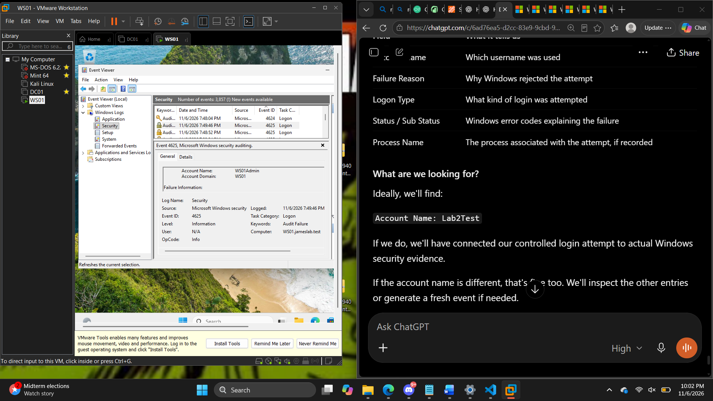
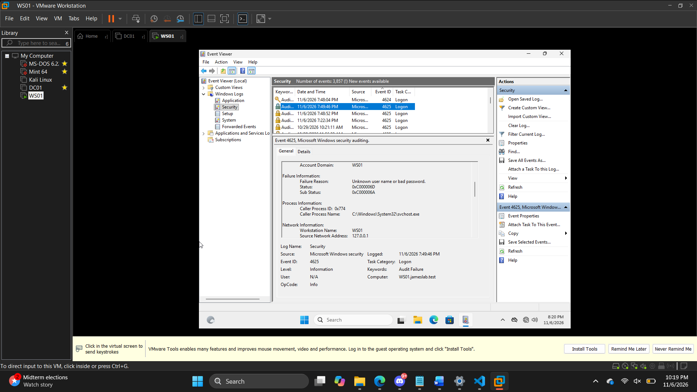
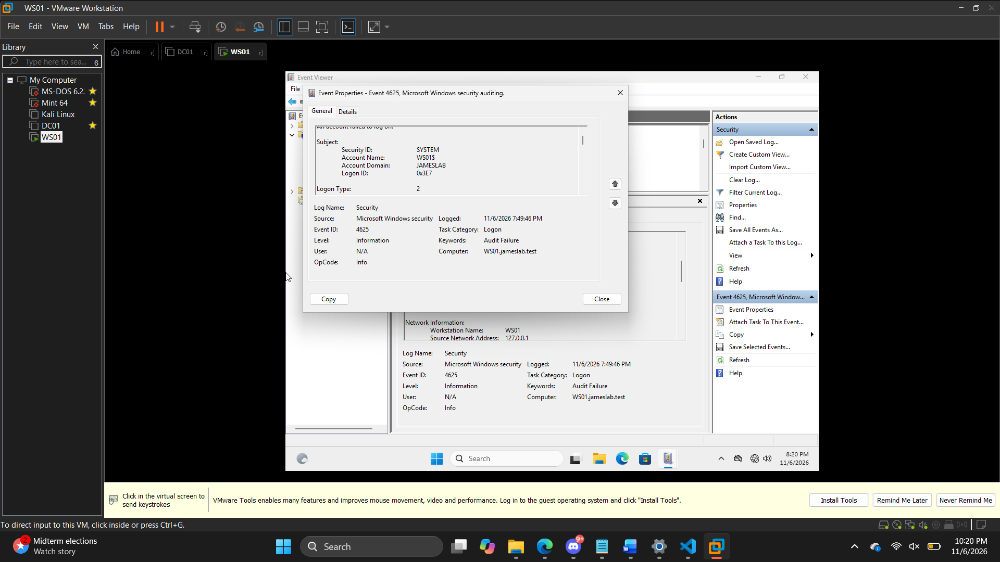

# Windows Security Event Investigation — Failed Logon (Event ID 4625)

## Project overview

This project documents a **defensive security investigation** using Windows Event Viewer to examine an unsuccessful workstation sign-in. The objective was to identify the affected account, interpret Windows authentication status codes, distinguish interactive from network logons, and assess whether the evidence justified escalation.

**Key finding:** A Windows 11 workstation recorded **Event ID 4625** for the local account `WS01Admin`. The event reported an **incorrect password** for an **interactive (Type 2)** logon. The available evidence does **not**, by itself, establish malicious activity.

## Lab environment

| Component | Configuration |
|---|---|
| Virtualization | VMware Workstation |
| Workstation | Windows 11 Enterprise Evaluation, `WS01` |
| Domain membership | `jameslab.test` |
| Security log source | Event Viewer → Windows Logs → Security |
| Event investigated | Windows Security Event ID `4625` — *An account failed to log on* |
| Network | Isolated virtual lab environment |

This investigation reused the workstation from my [Active Directory Security Administration lab](https://github.com/GarretJames/Active-Directory-Home-Lab).

## Investigation workflow

1. Opened Windows Event Viewer and navigated to **Windows Logs → Security**.
2. Located failed logon records with **Event ID 4625**.
3. Examined an existing failed logon event, including target account, logon type, failure reason, and status codes.
4. Compared the event's account information with the attempted lab test and searched the Security log for the proposed `Lab2Test` username.
5. Interpreted the observed event, recorded limitations, and identified appropriate follow-up actions.

## Evidence and findings

| Field | Observed value | Interpretation |
|---|---|---|
| Event ID | `4625` | Windows logged an unsuccessful sign-in |
| Logged date/time | November 6, 2026, 7:49:46 PM (WS01 clock) | Event timestamp reported by the guest VM |
| Computer | `WS01.jameslab.test` | Workstation recording the event |
| Target account | `WS01Admin` | Local account associated with the failed logon |
| Target account domain | `WS01` | Indicates the workstation-local account context |
| Logon type | `2` | Interactive logon |
| Failure reason | Unknown user name or bad password | Generic Windows failure message |
| Status | `0xC000006D` | Logon failure |
| Sub status | `0xC000006A` | Incorrect password |
| Source network address | `127.0.0.1` | Loopback address; does not identify an external source |
| Caller process | `C:\Windows\System32\svchost.exe` | Process reported by the event; not suspicious by itself |

The event's **Subject** shows the machine account `WS01$` in domain `JAMESLAB`. This is distinct from the **target account** `WS01Admin` whose authentication failed.

### Screenshots

**Target account and Event ID 4625:**

**Failure reason and Windows status codes:**

**Logon type 2 (interactive):**

## Security assessment

**Assessment: Inconclusive / low concern based on this event alone.** The record shows an incorrect password during an interactive sign-in, but one failed attempt does not demonstrate password guessing, compromise, or malicious intent. For a more confident assessment, an analyst would correlate adjacent logon failures and successes, verify account ownership and expected activity, review the affected workstation, and investigate repeated patterns.

### Recommended monitoring and response

- Watch for repeated Event ID 4625 records affecting one or multiple accounts.
- Correlate failures with successful sign-in events (e.g., Event ID 4624) and the relevant logon types.
- Investigate unusual account activity and review account lockout policies where appropriate.
- Maintain appropriate audit settings and synchronize system clocks for trustworthy event timelines.
- Escalate only when supporting evidence indicates suspicious behavior; do not treat a single failed password entry as a confirmed attack.

## Experiment limitations and troubleshooting

A controlled test was attempted with the username `Lab2Test`. The initial `runas` command returned **“Unable to acquire user password”** rather than a confirmed invalid-credentials response, and an Event Viewer search found **no event containing `Lab2Test`**. Therefore, this report **does not attribute** the observed `WS01Admin` event to that attempted simulation.

The guest VM clock also appeared inconsistent with the host clock, so the timestamp is documented as displayed by WS01 and should not be used for a cross-system timeline without time synchronization.

The lab demonstrates **event investigation and interpretation**, not a complete incident-response determination or a working automated detection rule.

## Skills demonstrated

- Windows Event Viewer navigation and Security log analysis
- Authentication event investigation (Event ID 4625)
- Windows NTSTATUS interpretation
- Interactive versus network logon concepts
- Evidence-based incident documentation and cautious security assessment
- Troubleshooting and documenting test limitations

---

**Portfolio author:** Garret James  
**Category:** Defensive Security / SOC Fundamentals  
**Date:** November 2026
